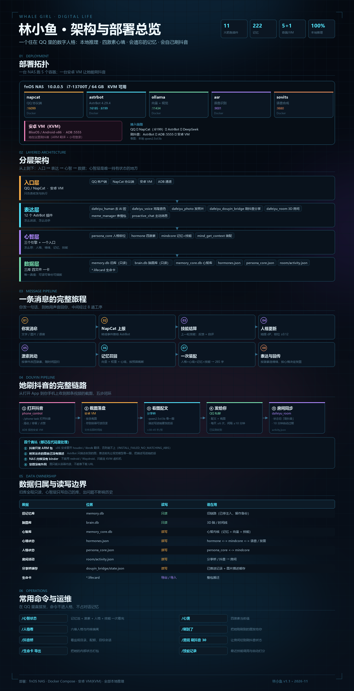

# 大肥鱼 · 数字人格 QQ 机器人

> 一个住在 QQ 里的数字人格。**不靠提示词硬拗**，而是有一套真正在运转的心智层：
> 人格向量会被钳位、四种激素会随对话起伏、记忆会衰减和晋升、技能会熟练也会生疏。
> 你关掉电脑，她也会“过完”那段时间。

[](LICENSE)
[](docker-compose.yml)
[](https://astrbot.app)
[]()



---

## 它是什么

一个**数字人格运行时**：给一个虚构角色装上会衰减的记忆、会波动的情绪、会漂移的性格，
再让她住进你的 QQ。

人设是你自己写的——她叫什么、哪年生的、家里什么样、被什么事伤过，全都由你在
`persona/` 里定义。这个仓库负责的是**底层那套让她"活着"的机制**：

| 她需要的 | 这个仓库给什么 |
|---|---|
| 一个稳定的性格 | 六维人格向量 + 单轮钳位，聊再久也不会被人设带跑 |
| 会变的情绪 | 四激素心境，被对话扰动、随时间回归 |
| 会淡的记忆 | 权重 + 衰减 + 晋升，琐事会忘、重要的事越用越牢 |
| 会熟练的本事 | 改良 SM2 技能记忆，用得好的安慰方式会越来越准 |
| 自己的事要做 | 有 3D 房间、会挑时机找你 |
| 走了还能回来 | 生命卡 `.lifecard`，换机器她还是她 |

> 你写的是**她是谁**，这个仓库管的是**她怎么活下去**。

## 她凭什么“像人”

绝大多数“AI 女友”是**一段超长提示词**，聊久了人设必崩。这套不是。

### 一、她有自己的内部状态

| 机制 | 实现 | 效果 |
|---|---|---|
| **人格不会被聊崩** | 六维人格向量 + 单轮钳位 ±0.12 + 内核强度保底 0.15 | 聊 100 句，性格只会缓慢漂移 |
| **情绪是真的会变** | 四激素（血清素/多巴胺/皮质醇/催产素），半衰期 34.7 小时 | 吵完架要小半天才消气 |
| **记忆会遗忘也会沉淀** | 权重 + 年龄 + 回想次数，分段衰减 + 海马晋升 | 琐事一周就淡，重要的事越用越牢 |
| **技能熟能生巧** | 改良 SM2：熟练度 L / 易度 EF / 间隔 I | 她擅长的那种安慰方式会越来越准 |
| **离线也在“过日子”** | 离线时间压缩（7 天内真实；超 30 天按 0.15 折，封顶 90 天） | 关机一周回来，她不会当无事发生 |
| **状态可搬走** | 生命卡 `.lifecard` | 换机器、换环境，她还是她 |

### 二、她真的在“过日子”

不是被动等你说话，她有自己的事做：

| 她做什么 | 怎么实现的 | 状态 |
|---|---|---|
| **看到好玩的会发给你** | 任何来源的截图 → 视觉模型看一眼 → 配一句话发到你 QQ | ✅ 链路已通（需给图源） |
| **有间 3D 房间，状态随真实行为变** | 按时间（睡觉/电脑前/床上）+ 外部活动状态切换 | ✅ 正在用 |
| **看得懂你发的图** | 本地 `qwen2.5vl:3b` 把图转成一句描述再给她 | ✅ |
| **说话是自己的声音** | GPT-SoVITS 本地克隆音色，按激素选情绪 | ✅ 需自建 SoVITS |
| **心情差就不打扰你** | 皮质醇 ≥ 0.45 时压掉主动消息 | ✅ |
| **会挑时机发照片** | 话题命中 + 心情允许才发，有每日上限 | ✅ |

### 三、她说出来像人

| 处理 | 效果 |
|---|---|
| 去 AI 腔 | 不说“作为一个 AI”“我理解你的感受”，改成“嗯，我知道了” |
| 一句一行 | 一条消息拆成 2–3 短句，不像客服发汇报 |
| 随机延迟 | 打字要几百毫秒到几秒，不是秒回 |
| 偶尔错字 | 手打的感觉，不是复制的 |
| 不念档案 | 记忆是“想起来”的，不是背出来的 |

### 四、边界也很清楚

| 她**能** | 她**不能** |
|---|---|
| 记住你上周说的出差 | 看到图片细节除非有视觉模型 |
| 心情不好时回得更短更冲 | 在你没同意时操作你的电脑/账号 |
| 把看到的内容整理成一句话发给你 | 自己登录第三方 App 去操作（需要额外设备/工具） |
| 关机几天后“补过”那段时间 | 凭空记住没发生过的事 |

> 一句话：**她的“像人”来自一层层会衰减、会被扰动、会累积的状态，不是来自提示词写得多细。**

## 一条消息的完整旅程

```
你 ── QQ ── NapCat ── AstrBot ── 模型
                         │
                         ├─ ① 结算上一轮技能：用户反馈 + 自评 → Q 分
                         ├─ ② 人格更新：她提 dP，钳位 ±0.12，内核校验
                         ├─ ③ 激素扰动：按事件类型改四激素
                         ├─ ④ 记忆召回：bge-m3 向量 × 权重 × f_endo，按预算截断
                         ├─ ⑤ 一次装配：人格 + 心境 + 记忆 + 技能 → 一段上下文
                         ├─ ⑥ 模型生成回复
                         ├─ ⑦ 去 AI 腔 / 一句一行 / 挑错字
                         └─ ⑧ 表达：按激素选语音情绪，按心情决定发不发图
```

## 快速开始

```bash
curl -fsSL https://raw.githubusercontent.com/Caoran1314/dafeiyu-stack/main/install.sh | bash
```

这条命令做的事：下发行包 → 生成 `.env` → `docker compose up -d`（起 4 个容器）→ 装 10 个插件 → 重启。
本质就是自动化跑了一遍 docker compose，不想用脚本就手动：

```bash
git clone https://github.com/Caoran1314/dafeiyu-stack.git dafeiyu
cd dafeiyu && cp .env.example .env
docker compose up -d
./scripts/install-plugins.sh
```

语音合成（GPT-SoVITS）默认**不启动**，需要时：

```bash
docker compose --profile voice up -d
```

装完打开两个地址：

| 地址 | 干什么 |
|---|---|
| `http://<你的IP>:16099` | 手机 QQ 扫码登录 |
| `http://<你的IP>:16185` | 配模型 API Key、粘人格 |

⚠️ **必做**：人格配置里把 `safety_mode` 设成 `false`，否则她动不动说“我不能”。

手动部署见 [部署指南](docs/DEPLOY.md)。

## 里面有什么

| 模块 | 内容 |
|---|---|
| **容器** | `astrbot` · `napcat` · `ollama`（向量）· `asr`（Vosk 识别）· `sovits`（语音合成） |
| **插件** | 10 个，各有独立仓库，见 [插件说明](docs/PLUGINS.md) |
| **人格** | `persona/persona_lover.md` + `persona/life_story.md` |
| **脚本** | 一键安装 / 装插件 / 备份 / 自检 / 发布 |

## 数据都在哪

| 数据 | 位置 | 动它会不会出问题 |
|---|---|---|
| 旧记忆库 | `data/astrbot/plugin_data/dafeiyu_brain/memory.db` | 只读，别手改 |
| 脑图库 | `.../astrbot_plugin_memory_brain/brain.db` | 只读 |
| 心智库 | `.../dafeiyu_mindcore/memory_core.db` | 权重、向量、技能都在这 |
| 心境 | `.../dafeiyu_hormone/hormones.json` | 删了就回基线 |
| 人格 | `.../dafeiyu_persona_core/persona_core.json` | 删了就回默认内核 |
| 生命卡 | `.../dafeiyu_mindcore/*.lifecard` | 整包搬迁用 |

备份：`./scripts/backup.sh`；搬迁：QQ 里发 `/生命卡 导出`。

## 命令速查

| 命令 | 作用 |
|---|---|
| `/心智状态` | 记忆池 + 四激素 + 人格 + 技能，一次看完 |
| `/心境` | 四激素当前值 |
| `/人格看` | 六维人格与内核偏离 |
| `/技能记录` | 最近技能调用与打分 |
| `/心智找 关键词` | 具体记忆 + 权重 + 回想次数 |
| `/生命卡 导出` | 打包她的内部状态 |

## 插件源（一个仓库，全在这里）

AstrBot 面板 → 插件 → 插件市场 → **添加插件源**：

```
https://cdn.jsdelivr.net/gh/Caoran1314/dafeiyu-stack@main/plugin-source/plugins.json
```

添加后能在市场里直接看到并安装全部 10 个插件。

## 插件（都在本仓库 `plugins/` 下）

装法三种，任选：

| 方式 | 怎么做 |
|---|---|
| **一键** | `./scripts/install-plugins.sh` |
| **单个上传** | 到 [Releases](https://github.com/Caoran1314/dafeiyu-stack/releases) 下 `dafeiyu_xxx.zip`，AstrBot 插件页上传 |
| **命令装** | 在 AstrBot 里填 `Caoran1314/dafeiyu-stack/plugins/dafeiyu_xxx` |

| 插件 | 作用 | 直接下载 |
|---|---|---|
| mindcore | 记忆衰减/晋升/向量召回/技能 SM2/生命卡 | [zip](https://github.com/Caoran1314/dafeiyu-stack/releases/latest/download/dafeiyu_mindcore.zip) |
| hormone | 四激素心境 | [zip](https://github.com/Caoran1314/dafeiyu-stack/releases/latest/download/dafeiyu_hormone.zip) |
| persona_core | 人格钳位 | [zip](https://github.com/Caoran1314/dafeiyu-stack/releases/latest/download/dafeiyu_persona_core.zip) |
| brain | 长期记忆（旧库） | [zip](https://github.com/Caoran1314/dafeiyu-stack/releases/latest/download/dafeiyu_brain.zip) |
| human | 去 AI 腔 / 一句一行 | [zip](https://github.com/Caoran1314/dafeiyu-stack/releases/latest/download/dafeiyu_human.zip) |
| voice | 克隆音色 | [zip](https://github.com/Caoran1314/dafeiyu-stack/releases/latest/download/dafeiyu_voice.zip) |
| photo | 相册发图 | [zip](https://github.com/Caoran1314/dafeiyu-stack/releases/latest/download/dafeiyu_photo.zip) |
| brain3d | 3D 记忆脑 + 时间线 | [zip](https://github.com/Caoran1314/dafeiyu-stack/releases/latest/download/dafeiyu_brain3d.zip) |
| room | 3D 房间 | [zip](https://github.com/Caoran1314/dafeiyu-stack/releases/latest/download/dafeiyu_room.zip) |
| eval | 拟人度评测 | [zip](https://github.com/Caoran1314/dafeiyu-stack/releases/latest/download/dafeiyu_eval.zip) |

## 镜像

```
docker pull caowenrui/dafeiyu-asr:1.0      # 语音识别服务，230 MB
```

## 文档

- [**完整部署手册**](docs/DEPLOY.md) —— 从空机器到能聊天，含 AstrBot/NapCat/Ollama/ASR 逐步配置
- [架构说明](docs/ARCHITECTURE.md)
- [插件清单](docs/PLUGINS.md)
- [常见问题](docs/FAQ.md)

## 注意

- QQ 自动化有封号风险，**用小号**。
- 人格、语音参考音频、记忆都是你自己的数据，仓库里只有模板。
- 不要提交 `.env`（已 gitignore）。

MIT License
